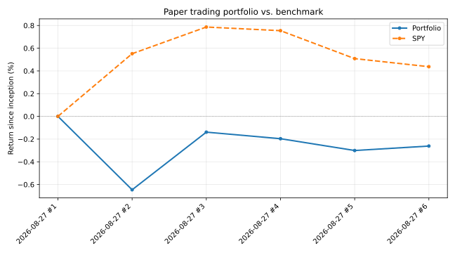

# Paper trading report

_Last updated: 2026-08-27T18:30:50_

## Performance

- **Current value:** $9,973.86 (started at $10,000.00)
- **Total return:** -0.26%
- **SPY return over same period:** +0.44%
- **Verdict:** 🔴 trailing the benchmark by 0.70 percentage points
- **Cash on hand:** $231.76

## Value over time

| Date | Portfolio value | Return | SPY return |
|---|---:|---:|---:|
| 2026-08-27 | $10,000.00 | +0.00% | +0.00% |
| 2026-08-27 | $9,935.37 | -0.65% | +0.55% |
| 2026-08-27 | $9,986.11 | -0.14% | +0.79% |
| 2026-08-27 | $9,980.33 | -0.20% | +0.75% |
| 2026-08-27 | $9,969.94 | -0.30% | +0.51% |
| 2026-08-27 | $9,973.86 | -0.26% | +0.44% |

## Current holdings

| Ticker | Shares | Avg cost | Current price | Market value | Gain/loss | % |
|---|---:|---:|---:|---:|---:|---:|
| NEM | 15.00 | $131.94 | $132.68 | $1,990.13 | 🟢 $10.96 | +0.55% |
| DASH | 8.00 | $235.97 | $230.84 | $1,846.72 | 🔴 $-41.02 | -2.17% |
| CTVA | 18.00 | $82.61 | $83.27 | $1,498.86 | 🟢 $11.91 | +0.80% |
| TRGP | 3.00 | $294.03 | $292.59 | $877.77 | 🔴 $-4.32 | -0.49% |
| EME | 1.00 | $773.59 | $774.46 | $774.46 | 🟢 $0.86 | +0.11% |
| TER | 2.00 | $365.42 | $364.21 | $728.42 | 🔴 $-2.42 | -0.33% |
| CTSH | 9.00 | $64.12 | $63.92 | $575.28 | 🔴 $-1.80 | -0.31% |
| VRTX | 1.00 | $548.27 | $548.26 | $548.26 | 🔴 $-0.01 | -0.00% |
| IQV | 2.00 | $264.00 | $264.23 | $528.46 | 🟢 $0.46 | +0.09% |
| BSX | 8.00 | $47.19 | $46.97 | $375.76 | 🔴 $-1.80 | -0.48% |

## Recent trades (of 19 total)

| Date | Action | Shares | Ticker | Price | Reason |
|---|---|---:|---|---:|---|
| 2026-08-27 | BUY | 8.00 | BSX | $47.19 | Well-rounded profile: reasonable valuation (PEG 0.72), decent profitability and growth, moderate leverage, and a large analyst-implied upside (~33%). Adds medtech exposure at a smaller position size to keep the new basket diversified rather than concentrated in one or two names. |
| 2026-08-27 | BUY | 2.00 | TER | $365.42 | Very low leverage (D/E 2.9) and strong current ratio (2.1) with PEG near 1 (0.93) and a supportive analyst target (~22% upside). Semiconductor test equipment adds sector diversification without the balance-sheet risk seen in some of today's other tech names. |
| 2026-08-27 | BUY | 1.00 | VRTX | $548.27 | One of the healthiest balance sheets in today's candidates: D/E of 9.8, current ratio 3.2, 35% profit margin, reasonable PEG (1.91) for a biotech, modest but real analyst upside. Prioritizing balance-sheet quality here over a flashier growth story. |
| 2026-08-27 | BUY | 1.00 | EME | $773.59 | Strong, non-distorted fundamentals: PEG 0.37 (cheap relative to growth), ROE 40.3%, low leverage (D/E 13.4), and analyst target ($1033) implies ~34% upside from here. Engineering/construction exposure diversifies away from the existing metals/ag/healthcare mix. |
| 2026-08-27 | SELL | 3.00 | RVTY | $128.79 | Weak on fundamentals: trailing PE near 62 with minimal revenue/earnings growth (~1%), thin profitability (ROE 3.2%, margin 8.2%), and no analyst coverage at all — the one data point resembling a target price sits below the current quote. Was bought purely on a smooth price chart; that basis no longer applies. |
| 2026-08-27 | SELL | 26.00 | FCX | $79.34 | Fundamentals no longer support this (was a pure price-momentum pick): PEG of 6.55 is expensive relative to growth, revenue growth is negative (-7.3%), and the analyst mean target ($72.05) sits below the current price ($79.34) — the Street itself sees this as overvalued right now. |
| 2026-08-27 | BUY | 9.00 | CTSH | $64.12 | New position: smooth, low-volatility 10-day climb (+9.75%) with only one minor dip, funded by the TRGP trim. Adds IT-services exposure uncorrelated with the existing metals/ag/healthcare mix. |
| 2026-08-27 | SELL | 2.00 | TRGP | $290.55 | Continued lower highs since entry (302.25 -> 294.03 -> 290.55) — the one holding showing an actual downtrend rather than a pause. Trimming rather than fully exiting since the move down has been shallow. |
| 2026-08-27 | BUY | 3.00 | RVTY | $128.56 | New position: steady staircase climb (+10% over 10 days, minimal volatility), adds life-sciences-tools diversification. |
| 2026-08-27 | BUY | 2.00 | IQV | $264.00 | New position: one of the smoothest uptrends in today's candidates (+11.6% over 10 days with almost no down days), adds healthcare-services exposure. |
| 2026-08-27 | BUY | 6.00 | CTVA | $82.07 | Uptrend intact with only a shallow 2-day pullback; still the least commodity-correlated name in the book, worth building out further. |
| 2026-08-27 | BUY | 2.00 | DASH | $233.08 | Minor one-day pullback (236.93->233.08) inside an otherwise smooth uptrend — not a trend change. Small add. |
| 2026-08-27 | BUY | 4.00 | NEM | $132.89 | Still grinding to new highs (133.09 today) with no reversal signal. Adding to a working position. |
| 2026-08-27 | BUY | 7.00 | FCX | $78.93 | Uptrend has flattened at highs (79 area) rather than reversing — consolidation, not exhaustion. Topping up within cap. |
| 2026-08-27 | BUY | 12.00 | CTVA | $82.88 | Gradual, low-volatility 10-day uptrend (+9.4%) in ag inputs; least commodity-price-driven of the group, further diversifying the basket. |
| 2026-08-27 | BUY | 5.00 | TRGP | $294.03 | Steady energy-infrastructure uptrend (+10%) with shallow pullbacks, adds sector diversification away from metals. |
| 2026-08-27 | BUY | 6.00 | DASH | $236.93 | Smooth, almost uninterrupted climb over 10 days (+9.6%), among the least choppy uptrends in the candidate list. |
| 2026-08-27 | BUY | 11.00 | NEM | $131.60 | Consistent 10-day uptrend (+15%) in gold miner with only minor pullbacks, suggesting sustained demand rather than a one-day pop. |
| 2026-08-27 | BUY | 19.00 | FCX | $79.00 | Steady, near-monotonic 10-day uptrend (+18%) in copper miner; no signs of a blow-off spike, just consistent grind higher. |
